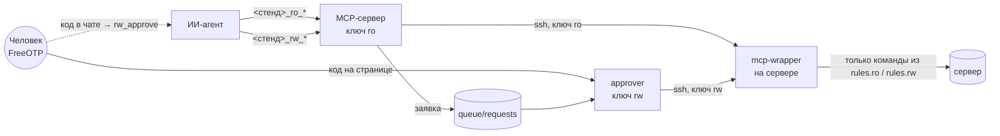
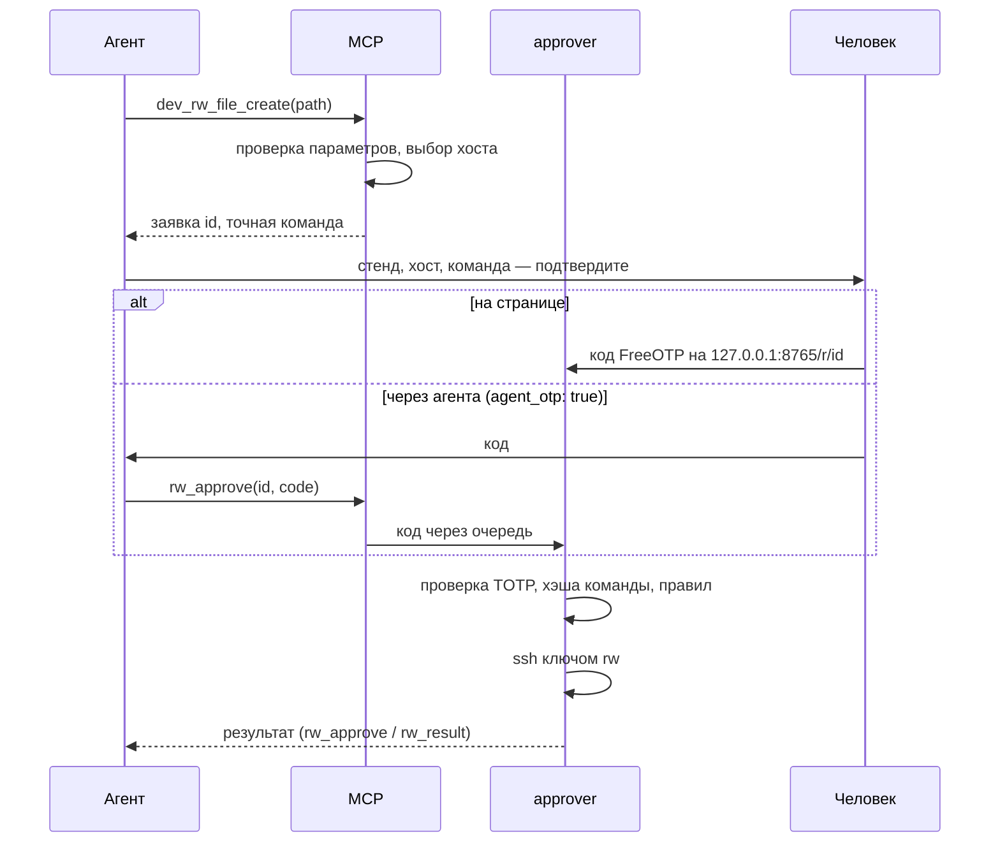

<div align="center">

# safety-mcp-server

**Безопасный MCP-доступ ИИ-агента к серверам по SSH: только заранее описанные команды,
изменения — только с одноразовым кодом от человека.**


</div>

---

## Содержание

- [Зачем](#зачем)
- [Возможности](#возможности)
- [Как это работает](#как-это-работает)
- [Быстрый старт](#быстрый-старт)
- [Инструменты для агента](#инструменты-для-агента)
- [Подтверждение изменений](#подтверждение-изменений)
- [Конфигурация](#конфигурация)
- [Добавление команд, стендов и хостов](#добавление-команд-стендов-и-хостов)
- [Модель безопасности](#модель-безопасности)
- [Разработка](#разработка)
- [Структура проекта](#структура-проекта)
- [Ограничения и планы](#ограничения-и-планы)
- [Лицензия](#лицензия)

## Зачем

Агенту полезно смотреть на серверы: место на дисках, статусы сервисов, логи. Давать ему shell опасно:
одна ошибка или подсказка-инъекция, и он выполнит что угодно. `safety-mcp-server` даёт агенту **список
именованных команд** вместо shell и требует **6-значный код из FreeOTP** для любого изменения.

## Возможности

- 🔒 **Только описанные команды.** Агент передаёт имя инструмента и параметры; параметры проверяются по шаблону.
- 🧱 **Двойная проверка.** Помимо MCP, команду проверяет обёртка на самом сервере (forced command в
  `authorized_keys`), правила для неё генерируются из того же `commands.json`.
- 🏷️ **Стенды и теги.** `dev`, `test`, `prod`, … в одном конфиге; хост выбирается по тегам ролей
  (`swarm_manager`, `swarm_worker`, …), стенд зашит в имя инструмента.
- ⚡ **Параллельно.** Команда на всех хостах с тегом выполняется параллельно (`max_parallel`).
- ✅ **Изменения по коду OTP.** Запись выполняет отдельный сервис `approver` с отдельным ключом после ввода
  кода FreeOTP на странице или через агента (если разрешено для стенда).
- 🌐 **HTTP-проверки.** `GET`/`HEAD` к адресам из конфига: код ответа, наличие текста, время; короткий или полный
  ответ (`mode=short|all`); привязанные к стенду или общие (`global`).
- 🧪 **Пробный запуск.** `dry_run=true` показывает хосты и точную команду, ничего не отправляя на сервер.
- 📴 **Без интернета.** TOTP, QR-код и проверки работают офлайн.
- 📝 **Аудит.** Каждый вызов пишется в журнал MCP, approver и в syslog сервера.

## Как это работает



| Компонент | Где работает | Что делает |
|---|---|---|
| `server.py` | контейнер `safety-mcp-server` | MCP-сервер (stdio) и CLI администратора |
| `approver.py` | контейнер `approver` | Страница подтверждения на `127.0.0.1:8765`, проверка TOTP, выполнение rw |
| `wrapper/mcp-wrapper` | `~/.mcp-ssh/` на каждом хосте | Принудительная команда для ключей MCP: пропускает только команды из правил |
| `wrapper/deploy.sh` | машина администратора | Генерирует правила и раскладывает обёртку на хосты |
| `wrapper/open-new-requests.sh` | машина администратора | Открывает страницу подтверждения при новой заявке |

MCP-сервер и approver — один образ, но **разные пользователи и тома**: ключ `rw` и секрет OTP есть только
у approver.

## Быстрый старт

Основной вариант: данные (конфиг, ключи, очередь, состояние) лежат в каталоге **`local/`** внутри проекта.
Он в `.gitignore` и `.dockerignore`, поэтому не попадёт ни в git, ни в образ. Все команды `docker compose`
запускаются из корня проекта с параметрами `--project-directory local -f docker-compose.yml`:

```bash
alias dc='docker compose --project-directory local -f docker-compose.yml'   # для удобства
```

<details>
<summary>Альтернатива: данные рядом с <code>docker-compose.yml</code></summary>

Создайте те же каталоги в корне проекта (без префикса `local/`) и запускайте `docker compose` без
`--project-directory`. Либо укажите любой другой каталог: `--project-directory ~/safety-mcp-data`.
Если нужного каталога нет, compose завершится ошибкой, а не создаст пустой.
</details>

### 1. Образ

```bash
docker compose build
# или без интернета: docker load < dist/safety-mcp-server-0.1.0.tar.gz
```

### 2. Ключи и каталоги

Проще всего скриптом: он создаёт `local/` из `conf.example/` и `.env.example`, генерирует ключи и ставит права.
Существующие файлы, ключи и секрет OTP он никогда не перезаписывает, поэтому запускать его можно повторно,
например чтобы добавить ключи нового стенда.

```bash
./init-local.sh --keys <стенд>          # можно несколько: --keys dev --keys prod
```

<details>
<summary>То же вручную</summary>

```bash
ssh-keygen -t ed25519 -N "" -f ~/.ssh/mcp_<стенд>_ro
ssh-keygen -t ed25519 -N "" -f ~/.ssh/mcp_<стенд>_rw

mkdir -p local/{conf,keys-ro,keys-rw,state,queue/requests,queue/results,approver-state}
cp ~/.ssh/mcp_<стенд>_ro* local/keys-ro/
mv ~/.ssh/mcp_<стенд>_rw local/keys-rw/ && cp ~/.ssh/mcp_<стенд>_rw.pub local/keys-rw/
chmod 700 local/keys-ro local/keys-rw && chmod 600 local/keys-ro/mcp_*_ro local/keys-rw/mcp_*_rw

# каталоги approver принадлежат APPROVER_UID (1001), остальные — MCP_UID (1000)
docker run --rm --user 0 --entrypoint chown -v "$PWD/local:/w" safety-mcp-server:0.1.0 \
  -R 1001:1001 /w/keys-rw /w/approver-state /w/queue/results
```

</details>

Приватный rw-ключ лежит только в `local/keys-rw/` и недоступен вашему пользователю. Так и задумано.

### 3. Конфиг

Скопируйте [`conf.example/`](conf.example/) в `local/conf/`, впишите хосты и добавьте ключи хостов:

```bash
cp conf.example/*.json local/conf/
ssh-keyscan -t ed25519 <адрес> >> local/conf/known_hosts.<стенд>   # сверьте отпечаток!
```

### 4. Обёртка на хостах

Выполняется вашим обычным доступом к `ssh_user`. Пользователей скрипт не создаёт, системные файлы не трогает.

```bash
MCP_SSH_CONF=$PWD/local/conf DEPLOY_SSH_KEY=~/.ssh/<ваш_ключ> DEPLOY_KEY_DIR=~/.ssh \
  wrapper/deploy.sh <стенд> --install-keys
```

В конце скрипт проверяет, что ro-ключ ограничен: произвольная команда должна получить отказ с кодом 126.

### 5. FreeOTP (один раз, в своём терминале)

```bash
docker compose --project-directory local -f docker-compose.yml run --rm approver enroll --account <имя>
```

Отсканируйте QR-код в FreeOTP («+», затем сканирование) и введите показанный код.

> [!NOTE]
> Часы машины и телефона должны совпадать с точностью до `APPROVER_TOTP_SKEW` секунд (по умолчанию 50).
> Если код не принимается, `enroll` и страница подсказывают, на сколько расходятся часы. Проверка:
> `timedatectl | grep synchronized` должно показывать `yes`.

> [!IMPORTANT]
> Запускайте `enroll` **в своём терминале**, а не через агента и не через `!` в чате: кто видел QR-код,
> тот может генерировать коды.

### 6. Запуск

```bash
docker compose --project-directory local -f docker-compose.yml up -d approver
wrapper/open-new-requests.sh local/queue/requests &

claude mcp add safety-mcp-server -- \
  docker compose --project-directory "$PWD/local" -f "$PWD/docker-compose.yml" run --rm -T safety-mcp-server
```

MCP работает и **без OTP**: команды `ro` доступны, `rw` возвращают ошибку с командой настройки
(текст задаётся переменной `MCP_ENROLL_HINT` в `local/.env`).

## Инструменты для агента

Правила работы агент получает **при подключении** (поле `instructions` MCP) и в инструменте `about`.

| Инструмент | Что делает |
|---|---|
| `about` | Правила работы: имена, порядок подтверждения, список стендов. Вызывается первым |
| `stands_list` | Стенды, разрешена ли запись, можно ли передавать код через агента, настроен ли OTP |
| `<стенд>_ro_hosts_list` | Хосты стенда с тегами (`tag` — фильтр) |
| `<стенд>_ro_<команда>` | Чтение. Выполняется сразу (SSH или HTTP) |
| `<стенд>_ro_endpoints_list` | HTTP-эндпоинты стенда |
| `global_ro_<команда>`, `global_ro_endpoints_list` | HTTP-проверки, не привязанные к стенду |
| `<стенд>_rw_<команда>` | Изменение. Создаёт заявку, ничего не выполняя |
| `rw_approve(id, code)` | Передать код OTP, который сообщил человек (если у стенда `agent_otp`) |
| `rw_result(id)` | Результат заявки |

У всех `ro` и `rw` команд есть параметры:

| Параметр | Когда |
|---|---|
| `host` | Обязателен для команд с `pick: host`, необязателен для остальных |
| `dry_run` | `true` — показать хосты/URL и итоговую команду; ничего не отправляется |
| `mode` | Только HTTP: `short` (по умолчанию) — PASS/FAIL, код и время; `all` — полный ответ: заголовки и тело |
| параметры команды | По шаблонам из `commands.json` |

<details>
<summary>Пример ответов</summary>

```text
=== dev_ro_disk_free_opt
[stand=dev host=dev-app1 role=ro] rc=0
Filesystem      Size  Used Avail Use% Mounted on
/dev/vda1        58G  4.1G   54G   8% /

=== dev_rw_file_create {"host": "dev-app1", "path": "mcp-sandbox/x.txt", "dry_run": true}
[stand=dev role=rw] ПРОБНЫЙ ЗАПУСК (dry_run): на сервер ничего не отправлено
хосты (1): dev-app1 (203.0.113.10)
команда: touch -- mcp-sandbox/x.txt
правило серверной обёртки rules.rw: совпадает
заявка НЕ создана.

=== prod_ro_http_server_is_life
[stand=prod endpoint=app GET https://app.example.com/]
RESULT: PASS status=200 time=510ms size=18234B
- status in [200]: ok
```
</details>

## Подтверждение изменений



| Правило | Значение |
|---|---|
| Попыток на заявку | 3, затем заявка отклоняется |
| Код | Одноразовый, допуск расхождения часов `APPROVER_TOTP_SKEW` (по умолчанию 50 с) |
| Срок заявки | 10 минут |
| Глобальная блокировка | 5 неверных кодов за 10 минут → 10 минут без подтверждений |
| Повторная проверка | Approver сверяет хэш команды и правила `write`, адрес хоста берёт из своего инвентаря |

> [!WARNING]
> При подтверждении через агента команду вам описывает агент. Сверяйте её с вызовом инструмента в
> интерфейсе клиента или открывайте страницу. Для prod держите `agent_otp: false`.

## Конфигурация

Каталог `local/conf/` (в контейнере `/etc/mcp-ssh`) монтируется **только для чтения**. Если конфиг доступен
на запись, сервер не стартует (для отладки: `MCP_SSH_ALLOW_WRITABLE=1`).

### `inventory.json`

```json
{
  "settings": {"max_parallel": 5, "max_hosts": 20},
  "stands": {
    "dev": {
      "ssh_user": "opsuser",
      "known_hosts": "known_hosts.dev",
      "keys": {"ro": "/keys/mcp_dev_ro", "rw": "/keys-rw/mcp_dev_rw"},
      "agent_otp": true,
      "hosts": {
        "dev-sw-m1": {"address": "10.10.0.11", "tags": ["swarm_manager", "docker"]},
        "dev-sw-w1": {"address": "10.10.0.21", "tags": ["swarm_worker", "docker"]}
      }
    }
  }
}
```

| Поле | Описание |
|---|---|
| `settings.max_parallel` | Сколько хостов одновременно при `pick: all` (1–50, по умолчанию 5); можно переопределить у стенда |
| `settings.max_hosts` | Максимум хостов в одном вызове (1–200, по умолчанию 20) |
| `ssh_user` | Существующий пользователь на хостах |
| `keys.ro` / `keys.rw` | Пути к ключам **внутри контейнера**; `rw` необязателен — без него у стенда нет rw-команд |
| `agent_otp` | Разрешить передачу кода через агента (`rw_approve`), по умолчанию `false` |
| `hosts.*.tags` | Произвольные теги ролей, количество не ограничено |

#### HTTP-эндпоинты

```json
"stands": {"prod": {"endpoints": {
  "app":      {"base_url": "https://app.example.com"},
  "internal": {"base_url": "https://intranet.example.local", "tls_verify": false}
}}},
"global": {"endpoints": {"sso": {"base_url": "https://sso.example.com"}}}
```

| Поле | Описание |
|---|---|
| `base_url` | Только `схема://хост[:порт]`, без пути и учётных данных; `https://`, `http://` — с `allow_http: true` |
| `tls_verify` | `false` — не проверять сертификат (самоподписанные и внутренние); по умолчанию `true`. В ответе помечается `tls_verify=off` |
| `ca_file` | Свой CA (файл в каталоге конфига) |

Стенд может состоять только из эндпоинтов, без хостов и ключей.

### `commands.json`

```json
{
  "common": {
    "read": {
      "disk_free_all": {"description": "Место по всем точкам монтирования", "pick": "all", "cmd": "df -h"}
    },
    "write": {
      "file_create": {
        "pick": "host",
        "params": {"path": "mcp-sandbox(/[A-Za-z0-9_][A-Za-z0-9._-]{0,63}){1,4}"},
        "cmd": "touch -- {path}"
      }
    }
  },
  "stands": {
    "dev": {"read": {"swarm_nodes_list": {"tags": ["swarm_manager"], "cmd": "sudo -n docker node ls"}}}
  }
}
```

| Поле | Описание |
|---|---|
| `common` / `stands.<стенд>` | Команды для всех стендов / только для одного; блок стенда может быть пустым |
| `description` | Необязательно; агент видит описание и шаблон команды |
| `tags` | Хост должен иметь все теги; `[]` — любой |
| `pick` | `first` — первый подходящий, `all` — все параллельно, `host` — агент указывает хост |
| `params` | Имя → regex в синтаксисе POSIX ERE (`[0-9]`, не `\d`) |
| `cmd` | Шаблон с `{param}`; запрещены `; \| & $ \` < > * ' "` |

HTTP-команда (только в блоке `read`):

```json
"login_form_check": {
  "type": "http", "scope": "stand", "endpoint": "app",
  "method": "GET", "path": "/login",
  "expect": {"status": [200], "body_contains": "<form", "max_ms": 3000}
}
```

| Поле | Описание |
|---|---|
| `scope` | `stand` — инструмент у каждого стенда, где есть такой `endpoint`; `global` — один инструмент `global_ro_<имя>` |
| `method` | `GET` или `HEAD` |
| `path` | Начинается с `/`; `{param}` подставляется с URL-кодированием |
| `expect` | `status` (список кодов), `body_contains`, `max_ms`; без `expect` — достаточно любого ответа |

## Добавление команд, стендов и хостов

| Что | Где | Дальше |
|---|---|---|
| Команда для всех стендов | `local/conf/commands.json` → `common.read` / `common.write` | `wrapper/deploy.sh <стенд>` для каждого стенда |
| Команда для одного стенда | `local/conf/commands.json` → `stands.<стенд>` | `wrapper/deploy.sh <стенд>` |
| Хост | `local/conf/inventory.json` → `stands.<стенд>.hosts`, ключ хоста в `known_hosts.<стенд>` | `wrapper/deploy.sh <стенд> <хост> --install-keys` |
| Стенд | `local/conf/inventory.json` → `stands`, ключи `mcp_<стенд>_ro/rw` | `wrapper/deploy.sh <стенд> --install-keys` |

После изменений переподключите MCP в клиенте (`/mcp` → reconnect). Проверка конфига:
`docker compose --project-directory local -f docker-compose.yml run --rm safety-mcp-server check`.

> [!CAUTION]
> Не добавляйте команды, умеющие запускать другие: `find -exec`, `awk`, `less`, `vim`, `tar`, `git`,
> `systemctl edit`, `docker exec`. И команды, пишущие в `~/.mcp-ssh` или `~/.ssh`.

## Модель безопасности

| Угроза | Защита |
|---|---|
| Агент выполняет произвольную команду | Нет shell: только имена инструментов, параметры по regex, `shell=False` |
| Обход MCP (ошибка в коде, подмена) | Обёртка на сервере пропускает только команды из правил, коды 126 на всё остальное |
| Агент сам одобряет изменение | Ключ `rw` и секрет OTP только у approver; код знает только человек |
| Подмена заявки в очереди | Approver проверяет хэш команды, правила `write`, срок, берёт адрес из инвентаря |
| Агент меняет конфиг | Конфиг монтируется `:ro`, сервер отказывается стартовать с записываемым конфигом |
| Перепутан стенд | Стенд в имени инструмента, в описании и в первой строке каждого ответа |
| Подмена хоста | `StrictHostKeyChecking=yes`, свой `known_hosts` на каждый стенд |
| HTTP как прокси к чужим адресам (SSRF) | URL только из инвентаря, итоговый хост сверяется с эндпоинтом, редиректы не выполняются, ответ ограничен 200 КБ, `Set-Cookie` и `Authorization` скрываются |
| Страница одобрения из браузера злоумышленника | Только `127.0.0.1`, проверка `Host` и `Origin`, CSRF, CSP, `no-store` |

> [!IMPORTANT]
> Всё это работает, только если у агента нет доступа к approver. Запретите в `settings.json` Claude Code:
>
> ```json
> {
>   "permissions": {
>     "deny": ["Bash(docker:*)", "Read(./local/keys-rw/**)", "Read(./local/approver-state/**)", "Edit(./local/conf/**)"],
>     "disableBypassPermissionsMode": "disable"
>   }
> }
> ```

## Разработка

```bash
python3 -m venv .venv
.venv/bin/pip install -r requirements-dev.txt
.venv/bin/python -m pytest -q
```

CLI администратора (без пакета `mcp`, на чистом Python):

```bash
MCP_SSH_CONF=local/conf python3 server.py check
MCP_SSH_CONF=local/conf python3 server.py list-hosts <стенд>
MCP_SSH_CONF=local/conf python3 server.py gen-rules <стенд> <хост> ro
```

## Структура проекта

```text
safety-mcp-server/
├── server.py                 # MCP-сервер и CLI
├── approver.py               # approver: serve / enroll
├── init-local.sh             # создание local/ из шаблонов и генерация ключей
├── safety_mcp/
│   ├── config.py             # загрузка и валидация конфига
│   ├── core.py               # выбор хостов, сборка команды, regex правил
│   ├── tools.py              # MCP-инструменты, about, dry_run, rw_approve
│   ├── sshexec.py            # ssh, параллельность, аудит
│   ├── httpcheck.py          # HTTP-проверки (стандартная библиотека)
│   ├── mcpserver.py          # FastMCP с отказом на лишние параметры
│   ├── queue.py              # очередь заявок и кодов
│   ├── approver.py           # страница подтверждения, TOTP, enroll
│   ├── rules.py              # генерация rules.ro / rules.rw
│   └── totp.py               # RFC 6238
├── wrapper/
│   ├── mcp-wrapper           # обёртка на сервере
│   ├── deploy.sh             # раскладка обёртки и ключей
│   └── open-new-requests.sh  # автооткрытие страницы
├── conf.example/             # пример конфига
├── tests/                    # pytest
├── docs/TASK.md              # полное техническое задание
├── local/                    # ваши данные (не в git): conf, keys-ro, keys-rw, state, queue, approver-state, .env
├── Dockerfile
└── docker-compose.yml
```

## Ограничения и планы

- [ ] HTTP: авторизация, заголовки, методы записи и запросы через хост стенда (`via`) — зарезервированы.
- [ ] Мультиплексирование SSH (`ControlMaster`) для ускорения повторных вызовов.
- [ ] Python 3.8/3.9 не поддерживаются: пакет `mcp` требует 3.10+.
- TOTP требует синхронизации часов машины с approver и телефона (`APPROVER_TOTP_SKEW`); без интернета нужен внутренний NTP.

## Лицензия

[Apache License 2.0](LICENSE)
